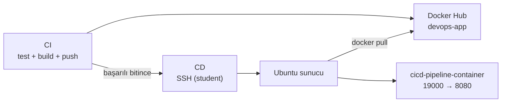

# GitHub Actions ile Ubuntu'ya Docker dağıtımı

Bu küçük Express uygulaması GitHub Actions ile test edilir, Docker Hub'daki private `devops-app` deposuna imaj olarak yollanır ve SSH üzerinden Ubuntu sunucuda container olarak çalıştırılır. İki workflow vardır:

- `.github/workflows/ci.yml` (**CI**): test, build ve Docker Hub push.
- `.github/workflows/cd.yml` (**CD - Deploy to Ubuntu**): CI başarıyla bitince otomatik başlar ve sunucuda container'ı günceller.



## 0. Projeyi kendi hesabınıza alın

Workflow'ları kendi GitHub hesabınızda çalıştırmak için projeyi **import** ile kendi hesabınıza alın. Fork kullanmayın: GitHub fork'larda workflow'ları kapalı getirir ve fork her zaman ana projeye bağlı kalır.

1. GitHub'da sağ üstteki **+** menüsünden **Import repository** seçin.
2. **The URL for your source repository** alanına `https://github.com/hakanbayraktar/ci-cd-docker.git` yazın.
3. **Owner** olarak kendi hesabınızı seçin, **Repository name** alanına `ci-cd-docker` yazın.
4. **Private** veya **Public** seçip **Begin import** düğmesine basın.
5. Import bitince açılan bağlantıyla kendi reponuza geçin.

Bundan sonraki bütün adımlar kendi reponuzda yapılır. Secret ve variable'lar import ile gelmez; 3. adımda kendi değerlerinizle eklersiniz.

## 1. Sunucuyu kontrol et

Aşağıdaki komutları sunucuda `student` kullanıcısıyla çalıştırın. Docker çalışmalı ve `student` kullanıcısı `docker` grubunda olmalıdır:

```bash
docker ps
```

Uygulama host'un `19000` portunu kullanır. Portu kullanan bir container olup olmadığına bakın:

```bash
docker ps --filter publish=19000
```

Çıktıda yalnızca `cicd-pipeline-container` görünüyorsa sorun yok; deploy onu yenisiyle değiştirir. SonarQube da `19000` portunu kullanır; çıktıda `sonarqube` görünüyorsa bu lab sırasında SonarQube çalışmamalıdır.

Uygulamaya DNS kaydı olmadan sunucunun IP adresiyle erişilir. Sunucunun firewall'unda TCP `19000` (uygulama) ve TCP `22` (SSH) açık olmalıdır.

<details>
<summary><strong>Docker kurulu olmayan boş bir Ubuntu sunucu</strong></summary>

Docker yoksa kurun ve kullanıcıyı `docker` grubuna ekleyin. Docker CE kurulu bir sunucuda `docker.io` kurmayın; paketler çakışır.

```bash
sudo apt update && sudo apt install -y docker.io
sudo systemctl enable --now docker
sudo usermod -aG docker student
```

Grup değişikliği için oturumu kapatıp yeniden açın.

</details>

## 2. SSH anahtarını oluştur ve yükle

CD workflow'u sunucuya `student` kullanıcısıyla, yalnızca bu iş için oluşturulan bir anahtarla bağlanır. Anahtarı sunucuda oluşturun. Workflow parola giremeyeceği için anahtara parola konmaz (`-N ""`):

```bash
ssh-keygen -t ed25519 -C "github-actions-deploy" -f ~/.ssh/github_actions_deploy -N ""
```

Public anahtarı `student` kullanıcısının yetkili anahtarlarına ekleyin:

```bash
cat ~/.ssh/github_actions_deploy.pub >> ~/.ssh/authorized_keys
```

```bash
chmod 600 ~/.ssh/authorized_keys
```

Anahtarla bağlanılabildiğini deneyin. Çıktı `docker ps` listesidir:

```bash
ssh -i ~/.ssh/github_actions_deploy -o IdentitiesOnly=yes -o StrictHostKeyChecking=accept-new student@localhost 'docker ps'
```

Private anahtarı ekrana yazdırın; 3. adımda `SSH_PRIVATE_KEY` değeri olarak bunu kopyalayacaksınız:

```bash
cat ~/.ssh/github_actions_deploy
```

Sunucunun public IP adresi (`SERVER_IP`):

```bash
curl -s ifconfig.me; echo
```

## 3. Secret ve variable'ları ekle

Docker Hub'da private `devops-app` reposu olmalı. Token kullanın; Docker Hub parola kullanmayın.

Reponuzda **Settings → Secrets and variables → Actions** sayfasını açın. Secret'ları **Secrets** sekmesinde **New repository secret**, variable'ları **Variables** sekmesinde **New repository variable** ile ekleyin:

| Tür | Ad | Değer |
| --- | --- | --- |
| Secret | `DOCKER_USERNAME` | Docker Hub kullanıcı adı |
| Secret | `DOCKERHUB_TOKEN` | Docker Hub access token |
| Secret | `SSH_PRIVATE_KEY` | `cat ~/.ssh/github_actions_deploy` çıktısının tamamı (`-----BEGIN` ve `-----END` satırları dahil) |
| Variable | `SERVER_IP` | Sunucunun public IP adresi |
| Variable | `SSH_USER` | `student` |

## 4. Dağıtım

İlk çalıştırmayı elle başlatın: **Actions → CI → Run workflow** yolunu açın, `main` dalını seçip **Run workflow** düğmesine basın. Sonraki her `main` push'u CI'ı kendiliğinden başlatır.

CI başarıyla bitince **CD - Deploy to Ubuntu** otomatik başlar. CI başarısız olursa (örneğin test kırılırsa) CD çalışmaz ve sunucudaki container değişmez. GitHub-hosted `ubuntu-latest` runner kullanılır; ayrıca runner kurmanız gerekmez.

Her dağıtım commit SHA etiketi kullanır ve sunucuda eski `cicd-pipeline-container` kaldırılır.

CD bitince sunucuda container'ı görün. `PORTS` sütununda `0.0.0.0:19000->8080/tcp` yazar:

```bash
docker ps --filter name=cicd-pipeline-container
```

```bash
curl -s http://localhost:19000/; echo
```

Sunucuda port `19000`, container içinde ise uygulama portu `8080` kullanılır. Tarayıcıdan açılacak adres:

```bash
echo "http://$(curl -s ifconfig.me):19000"
```

## Temizlik

Container'ı silin:

```bash
docker rm -f cicd-pipeline-container
```

Workflow'un anahtarını `authorized_keys` dosyasından çıkarın ve anahtar dosyalarını silin:

```bash
sed -i '/github-actions-deploy/d' ~/.ssh/authorized_keys
```

```bash
rm -f ~/.ssh/github_actions_deploy ~/.ssh/github_actions_deploy.pub
```
