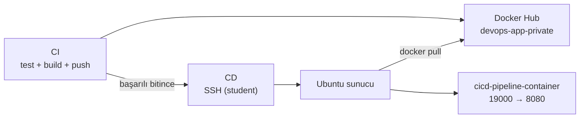

# GitHub Actions ile Ubuntu'ya Docker dağıtımı

**CI** workflow'u kodu test eder ve imajı Docker Hub'daki private `devops-app-private` reposuna yollar. CI başarılı bitince **CD - Deploy to Ubuntu** SSH ile sunucuda container'ı günceller.



## 0. Projeyi kendi hesabınıza alın

Projeyi import ile alın; fork'ta workflow'lar kapalı gelir.

**+ → Import repository** → `https://github.com/hakanbayraktar/ci-cd-docker.git` → **Owner**: kendi hesabınız, **Repository name**: `ci-cd-docker` → **Begin import**.

Sonraki adımlar kendi reponuzda yapılır.

## 1. Sunucuyu kontrol et

Sunucuda `student` kullanıcısıyla Docker çalışmalıdır:

```bash
docker ps
```

<details>
<summary><strong>Docker kurulu değilse</strong></summary>

Docker CE kurulu sunucuda `docker.io` kurmayın; paketler çakışır.

```bash
sudo apt update && sudo apt install -y docker.io
sudo systemctl enable --now docker
sudo usermod -aG docker student
```

Ardından oturumu kapatıp yeniden açın.

</details>

## 2. SSH anahtarını oluştur

CD sunucuya `student` kullanıcısıyla bu anahtarla bağlanır. Anahtarı sunucuda, parolasız oluşturun:

```bash
ssh-keygen -t ed25519 -C "github-actions-deploy" -f ~/.ssh/github_actions_deploy -N ""
```

```bash
cat ~/.ssh/github_actions_deploy.pub >> ~/.ssh/authorized_keys
```

```bash
chmod 600 ~/.ssh/authorized_keys
```

Anahtarla bağlanmayı deneyin; `docker ps` çıktısı gelir:

```bash
ssh -i ~/.ssh/github_actions_deploy -o IdentitiesOnly=yes -o StrictHostKeyChecking=accept-new student@localhost 'docker ps'
```

3\. adımda gerekecek private anahtar ve sunucu IP'si:

```bash
cat ~/.ssh/github_actions_deploy
```

```bash
curl -s ifconfig.me; echo
```

## 3. Secret ve variable'ları ekle

Docker Hub'da private `devops-app-private` reposu ve bir access token gerekir.

**Settings → Secrets and variables → Actions** sayfasında ekleyin:

| Tür | Ad | Değer |
| --- | --- | --- |
| Secret | `DOCKER_USERNAME` | Docker Hub kullanıcı adı |
| Secret | `DOCKERHUB_TOKEN` | Docker Hub access token |
| Secret | `SSH_PRIVATE_KEY` | `cat ~/.ssh/github_actions_deploy` çıktısının tamamı |
| Variable | `SERVER_IP` | Sunucunun IP adresi |
| Variable | `SSH_USER` | `student` |

## 4. Workflow'u çalıştır

**Actions → CI → Run workflow** → `main` → **Run workflow**. CI bitince CD kendiliğinden başlar. Sonraki her `main` push'u CI'ı başlatır.

CD bitince sunucuda kontrol edin:

```bash
docker ps --filter name=cicd-pipeline-container
```

```bash
curl -s http://localhost:19000/; echo
```

Tarayıcı adresi:

```bash
echo "http://$(curl -s ifconfig.me):19000"
```

## Temizlik

```bash
docker rm -f cicd-pipeline-container
```

```bash
sed -i '/github-actions-deploy/d' ~/.ssh/authorized_keys
```

```bash
rm -f ~/.ssh/github_actions_deploy ~/.ssh/github_actions_deploy.pub
```
